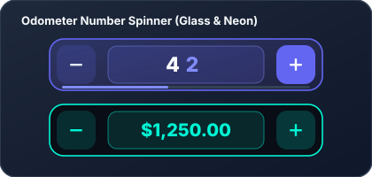
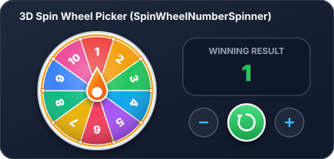
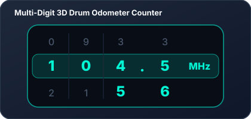
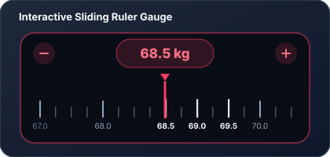

<p align="center">
  
</p>

# number_spinner

[](https://pub.dev/packages/number_spinner)
[](https://opensource.org/licenses/MIT)
[](https://flutter.dev)
[](https://pub.dev/packages/number_spinner)
[](https://humanize.id)

A modern, eye-catching animated number spinner, 3D cylindrical wheel picker, rolling-digit odometer counter, multi-digit drum roller, and interactive sliding ruler widget library for Flutter. Zero external dependencies, precision-safe decimal math, and full `FormField` integration.

> 🌟 Supported & Powered by [Humanize AI](https://humanize.id)

<p align="center">
  
</p>

---

## 🎬 Live Visual Preview

| 1. Odometer Number Spinner (`odometer`) | 2. 3D Spin Wheel Picker (`SpinWheelNumberSpinner`) |
| :---: | :---: |
|  |  |
| Per-character rolling digit transition, drag-to-spin, tap-to-edit, and bottom progress bar. | Colorful 3D circular lucky spin wheel with numbered pie slices, center pointer hub, weighted odds, and `[-]` `[↻]` `[+]` controls. |

| 3. Multi-Digit 3D Drum Counter (`MultiDigitNumberSpinner`) | 4. Interactive Sliding Ruler (`ruler`) |
| :---: | :---: |
|  |  |
| Spin each place-value digit column (`100s`, `10s`, `1s`, `.1s`) independently. | Snap-to-step tick gauge with glowing center pointer needle and live odometer readout badge. |

---

## ✨ Features

- 🎡 **5 Eye-Catching Interactive Layouts** (`NumberSpinnerLayout` & `SpinWheelNumberSpinner`):
  - `SpinWheelNumberSpinner` / `NumberSpinnerLayout.spinWheel` — Colorful 3D circular lucky spin wheel / roulette number picker with numbered pie slices (`1..10+`), central teardrop pointer hub, realistic deceleration physics, weighted winning probabilities (`weights`), dynamic slice controls (`[-]` `[↻]` `[+]`), and `excludeNumber()` support.
  - `NumberSpinnerLayout.odometer` — Rolling-digit odometer capsule with drag-to-spin gestures, tap-to-edit inline input, and stepper buttons.
  - `NumberSpinnerLayout.wheelVertical` — 3D vertical cylindrical drum wheel picker with magnification lens and gradient edge fades.
  - `NumberSpinnerLayout.wheelHorizontal` — 3D horizontal carousel wheel picker with center lens highlight.
  - `NumberSpinnerLayout.ruler` — Interactive sliding tick-mark gauge ruler with center pointer needle and live digital readout header.
- 🔢 **Standalone Odometer & Multi-Digit Drum Widgets**:
  - `OdometerNumberText` — Per-character directional rolling digit text widget for live counters, prices, and dashboards.
  - `MultiDigitNumberSpinner` — Independent place-value 3D digit drum columns (`100s`, `10s`, `1s`, `.1s`) for hardware counters, frequency tuners, and combination dials.
- 🎨 **5 Modern Theme Presets** (`NumberSpinnerStyle`):
  - `NumberSpinnerStyle.modern()` — Clean Material 3 surface with soft focus glow.
  - `NumberSpinnerStyle.glass()` — Translucent frosted glassmorphic surface and luminous border.
  - `NumberSpinnerStyle.neon()` — High-contrast dark cyber style with glowing neon digits and progress bar.
  - `NumberSpinnerStyle.minimal()` — Ultra-clean borderless capsule.
  - `NumberSpinnerStyle.soft()` — Tactile soft-UI contours with dual shadows.
- 🧮 **Precision-Safe Decimal Math** (`NumberSpinnerMath`):
  - Eliminates IEEE 754 floating-point drift (`0.1 + 0.2 == 0.3` guaranteed).
  - Supports cyclic wrap-around mode (`loop: true`) for clocks (`00..23`, `00..59`), angles (`0°..359°`), and cyclic dials.
- 💱 **Built-in Formatting Presets** (`NumberSpinnerFormat`):
  - `standard()`, `decimal()`, `padded()` (zero-padded e.g. `01`, `02`), `currency()`, `european()`, `percentage()`, `unit()`, and `custom()`.
- ⚡ **Rich Desktop, Web & Mobile Ergonomics**:
  - Drag-to-spin vertical/horizontal gestures, long-press turbo auto-repeat, mouse scroll wheel support, and keyboard shortcuts (`ArrowUp`/`ArrowDown`, `PageUp`/`PageDown`, `Home`/`End`).
- 📋 **Form Validation Ready**:
  - `NumberSpinnerFormField` integrates directly with Flutter's `Form`, `validator`, `onSaved`, `reset()`, and `AutovalidateMode`.

---

## 📦 Installation

Add `number_spinner` to your `pubspec.yaml`:

```yaml
dependencies:
  number_spinner: ^1.0.5
```

Or install via the Flutter CLI:

```bash
flutter pub add number_spinner
```

---

## 🚀 Quick Start

```dart
import 'package:flutter/material.dart';
import 'package:number_spinner/number_spinner.dart';

class QuantitySpinnerDemo extends StatelessWidget {
  const QuantitySpinnerDemo({super.key});

  @override
  Widget build(BuildContext context) {
    return NumberSpinner(
      labelText: 'Quantity',
      initialValue: 5,
      min: 0,
      max: 100,
      step: 1,
      style: NumberSpinnerStyle.modern(showProgressIndicator: true),
      onChanged: (value) {
        debugPrint('Selected value: $value');
      },
    );
  }
}
```

---

## 📖 Usage Examples

### 1. 3D Circular Spin Wheel (`SpinWheelNumberSpinner`)

```dart
final wheelController = SpinWheelController(
  min: 1,
  max: 10,
  step: 1,
  // Optional custom winning probability weights per number:
  weights: {7: 3.0, 10: 2.0},
);

SpinWheelNumberSpinner(
  labelText: 'Lucky Spin Number',
  controller: wheelController,
  wheelSize: 260,
  showControlBar: true,   // Displays [-] [SPIN] [+] buttons
  showResultBadge: true,  // Displays Winning Result card
  onSpinEnd: (winner) {
    debugPrint('Winning number: $winner');
    // Optionally exclude winner from next spin:
    // wheelController.excludeNumber(winner);
  },
);
```

### 2. Odometer Capsule, 3D Vertical Wheel, Horizontal Carousel & Sliding Ruler

```dart
// 1. Odometer Capsule with Glassmorphic Theme
NumberSpinner(
  labelText: 'Odometer Spinner',
  initialValue: 25,
  min: 0,
  max: 100,
  layout: NumberSpinnerLayout.odometer,
  style: NumberSpinnerStyle.glass(showProgressIndicator: true),
)

// 2. 3D Vertical Drum Wheel with Looping (e.g. Hours 00..23)
NumberSpinner(
  labelText: 'Alarm Hour',
  initialValue: 8,
  min: 0,
  max: 23,
  loop: true,
  layout: NumberSpinnerLayout.wheelVertical,
  buttonPosition: NumberSpinnerButtonPosition.topBottom,
  format: const NumberSpinnerFormat.padded(width: 2),
)

// 3. 3D Horizontal Carousel Wheel
NumberSpinner(
  labelText: 'Level Multiplier',
  initialValue: 3,
  min: 1,
  max: 10,
  layout: NumberSpinnerLayout.wheelHorizontal,
  format: const NumberSpinnerFormat(suffix: 'x'),
)

// 4. Interactive Sliding Ruler Gauge
NumberSpinner(
  labelText: 'Target Weight',
  initialValue: 70.5,
  min: 40,
  max: 150,
  step: 0.5,
  precision: 1,
  layout: NumberSpinnerLayout.ruler,
  format: const NumberSpinnerFormat.unit(unit: 'kg', padDecimals: true),
  style: NumberSpinnerStyle.modern(showProgressIndicator: true),
)
```

### 2. Neon Cyber & Soft Theme Presets

```dart
// Glowing Neon Cyber Spinner
NumberSpinner(
  initialValue: 1250,
  min: 0,
  max: 5000,
  step: 50,
  format: const NumberSpinnerFormat.currency(symbol: r'$', padDecimals: false),
  style: NumberSpinnerStyle.neon(
    accentColor: const Color(0xFF00F5D4),
  ),
)

// Tactile Soft-UI Spinner
NumberSpinner(
  initialValue: 65,
  min: 0,
  max: 100,
  step: 5,
  format: const NumberSpinnerFormat.percentage(),
  style: NumberSpinnerStyle.soft(),
)
```

### 3. Multi-Digit 3D Drum Spinner (`MultiDigitNumberSpinner`)

Spin each place-value digit column (`100s`, `10s`, `1s`, `.1s`) independently:

```dart
MultiDigitNumberSpinner(
  labelText: 'Frequency Tuner (MHz)',
  initialValue: 104.5,
  min: 88.0,
  max: 108.0,
  integerDigits: 3,
  decimalDigits: 1,
  suffixText: 'MHz',
  style: NumberSpinnerStyle.neon(
    accentColor: const Color(0xFF38BDF8),
  ),
  onChanged: (frequency) {
    debugPrint('Tuned to: $frequency MHz');
  },
)
```

### 4. Standalone Rolling Odometer Text (`OdometerNumberText`)

```dart
OdometerNumberText(
  value: 14920.75,
  precision: 2,
  format: const NumberSpinnerFormat.currency(symbol: r'$'),
  style: const TextStyle(fontSize: 28, fontWeight: FontWeight.w800),
)
```

### 5. Programmatic Control (`NumberSpinnerController`)

```dart
final controller = NumberSpinnerController(
  value: 10,
  min: 0,
  max: 100,
  step: 5,
);

NumberSpinner(controller: controller);

// Programmatic operations
controller.increment();          // 15
controller.decrement(2);         // 5
controller.setValue(75);         // 75
controller.reset();              // 10
debugPrint('${controller.progress}'); // 0.1
```

### 6. Form Validation (`NumberSpinnerFormField`)

```dart
NumberSpinnerFormField(
  labelText: 'Team Seats',
  initialValue: 5,
  min: 1,
  max: 50,
  step: 1,
  autovalidateMode: AutovalidateMode.onUserInteraction,
  validator: (value) {
    if (value == null || value < 3) {
      return 'Minimum team size is 3 seats';
    }
    return null;
  },
  onSaved: (value) {
    debugPrint('Saved team seats: $value');
  },
)
```

---

## ⌨️ Gestures, Keyboard & Mouse Controls

| Interaction | Action |
| :--- | :--- |
| **Tap `+` / `-`** | Increments or decrements by `step` |
| **Long-press `+` / `-`** | Continuous auto-repeat with progressive turbo acceleration |
| **Drag Up / Right** | Spins value upward continuously (`odometer` layout) |
| **Drag Down / Left** | Spins value downward continuously (`odometer` layout) |
| **Tap Value** | Opens inline direct numeric text editor (`odometer` layout) |
| **Tap Wheel / Ruler Item** | Smoothly animates wheel or ruler to the tapped step |
| **`ArrowUp` / `ArrowRight`** | Increments by `step` when focused |
| **`ArrowDown` / `ArrowLeft`** | Decrements by `step` when focused |
| **`PageUp` / `PageDown`** | Steps by `largeStepCount` (`10` steps by default) |
| **`Home` / `End`** | Jumps directly to `min` or `max` |
| **Mouse Scroll Wheel** | Steps up or down when hovered/focused |

---

## 💖 Support & Sponsor

This open-source library is proudly supported and powered by **[Humanize AI](https://humanize.id)** — an advanced AI platform for natural and human-like content generation.

- **Website**: [Humanize AI](https://humanize.id)
- **Repository**: [https://github.com/andikpbw/flutter-number-spinner.git](https://github.com/andikpbw/flutter-number-spinner.git)
- **Issue Tracker**: [GitHub Issues](https://github.com/andikpbw/flutter-number-spinner/issues)

---

## 📄 License

Released under the [MIT License](LICENSE).
